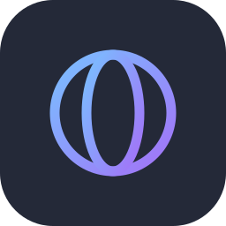

 

 

 

<!-- 

 -->

&nbsp;

&nbsp;

&nbsp;

&nbsp;

&nbsp;

&nbsp;

 

&nbsp;

---

*Just a developer, a keyboard, and a whole lot of ideas.*

### Hey there! I'm Harsh 👋

I'm a developer from India who loves building modern, interactive, and visually appealing web experiences.

I enjoy exploring the intersection of **Frontend Development and AI Engineering**, turning creative ideas into functional applications.

Currently learning more about LLMs, AI agents, RAG, and intelligent software systems.

### 🧸 A Few Things I Love Building

- 💻 Modern web applications with React and Next.js.
- 🎨 Beautiful UI/UX experiences with smooth animations.
- 🤖 AI-powered applications, LLMs, and intelligent systems.
- ⚡ Full-stack applications with real-world functionality.
- 🌐 Creative 3D web experiences.
- ✍️ Technical writing and sharing what I learn.

---

*♡ Little ideas, big ambitions. ♡*

<table>
<tr>
<td width="50%" valign="top">

### 🛍️ NUVORA
**A Modern E-commerce Experience**

✦ DESIGN · DEVELOPMENT · COMMERCE ✦

A modern shopping platform with product management, authentication, admin dashboard and a seamless shopping experience.

</td>
<td width="50%" valign="top">

### 🤖 morphoMind
**A Multi-Model AI Universe**

✦ EXPERIMENT · EXPLORE · INNOVATE ✦

An AI-powered platform bringing multiple AI models and intelligent features together in one unified experience.

</td>
</tr>

<tr>
<td width="50%" valign="top">

### 🌐 Developer Portfolio
**An Interactive 3D Experience**

✦ DESIGN · ANIMATION · CREATIVITY ✦

A personal portfolio showcasing projects and skills through immersive 3D visuals and smooth animations.

</td>
<td width="50%" valign="top">

### 🧠 AI Engineering
**Exploring the Future of AI**

✦ LEARN · BUILD · EXPERIMENT ✦

Exploring LLMs, AI agents, RAG systems and practical AI engineering concepts through hands-on experiments.

</td>
</tr>
</table>

*The little tools that help me build big things.*

 

### 🌷 FRONTEND DEVELOPMENT

### 🧩 BACKEND & DATABASE

### 🤖 AI & INTELLIGENT SYSTEMS

 

`LLMs` · `AI Agents` · `RAG` · `Prompt Engineering` · `Context Engineering`

### 🎨 CREATIVE DEVELOPMENT & TOOLS

---

*Every contribution is a little step forward.*

 

  

  

---

*Little green squares, lots of happy coding.*

---

*Because there's always something new to discover.*

I believe great developers never stop learning.

Apart from building applications, I enjoy exploring new technologies, understanding how things work behind the scenes, and sharing what I learn with the developer community.

### ✍️ Things I Love Exploring

`FRONTEND DEVELOPMENT` · `AI ENGINEERING` · `LLMs` · `AI AGENTS` · `WEB DEVELOPMENT`

 

  

## 🤎 LET'S CONNECT & CREATE

*Have an idea? Let's build something wonderful together.*

 

  

### 🐹 Made with curiosity, coffee & a little bit of code.

**♡ Building today. Dreaming bigger tomorrow. ♡**

